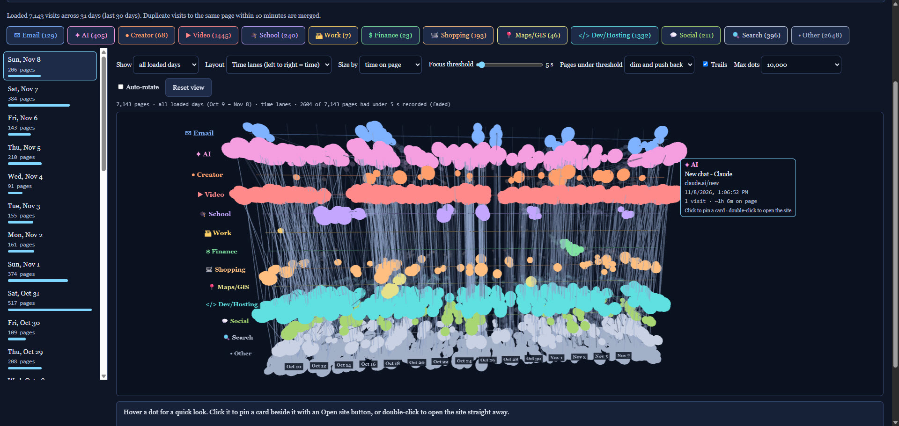

# Browse History Recall

A day-by-day, color-coded timeline of your Chrome browsing history, with an interactive 3D view. Everything runs locally in your browser. Your History file is never uploaded anywhere.

## Features

- Day-by-day timeline of your Chrome history
- Pages auto-sorted into categories (Email, AI, Video, Work, Finance, Shopping, Social, Search and more)
- 3D time-lane view: size dots by time on page, focus threshold, trails, auto-rotate
- Hover for a quick look, click to pin a card, double-click to open the site
- 100% client-side: reads the SQLite History file with sql.js in your browser

## Usage

1. Open `index.html` in your browser (or use the GitHub Pages demo if enabled for this repo).
2. Click **Open Chrome History file** and pick your History file. The in-app guide shows where it lives on Windows, macOS and Linux. On Windows it is under `%LOCALAPPDATA%\Google\Chrome\User Data\Default\History`.
3. If Chrome is open, copy the History file to your desktop first and open the copy.

## Privacy

No data leaves your machine. The only network requests are for the sql.js and three.js libraries from public CDNs. Do not commit your own History file to this repo; the `.gitignore` blocks common names.

## License

MIT. See [LICENSE](LICENSE).
